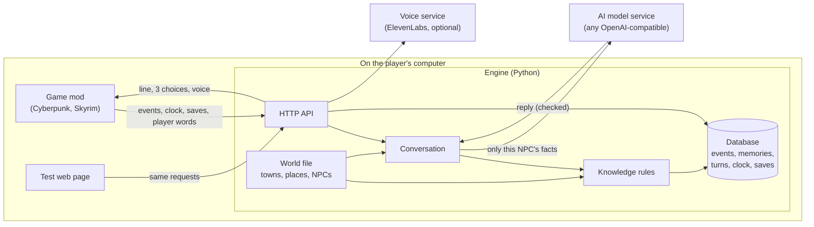
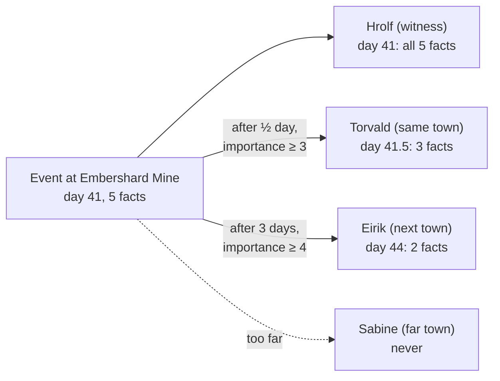
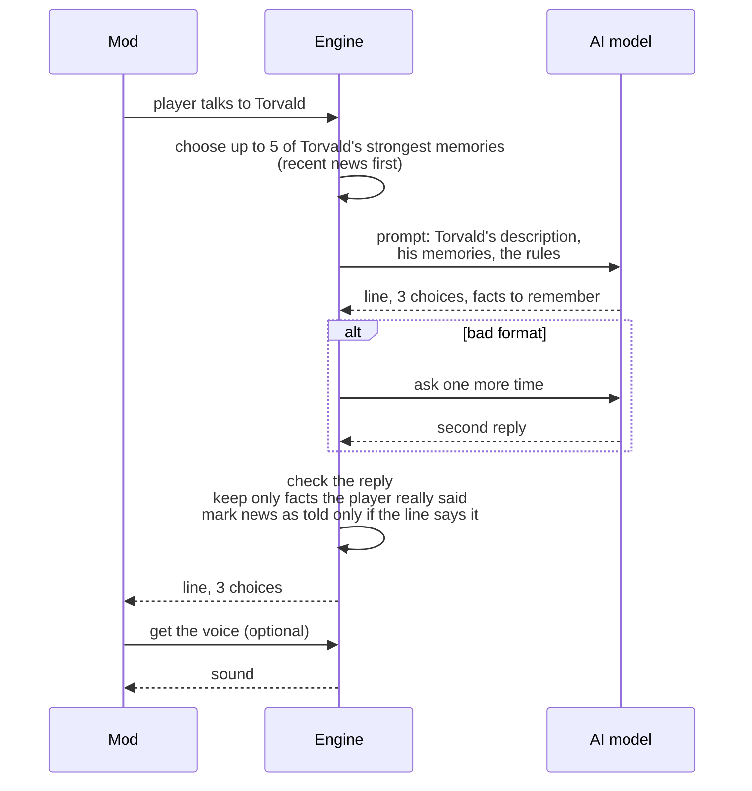
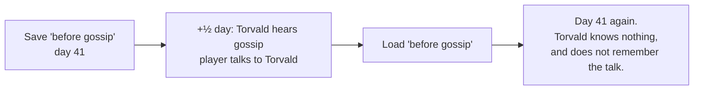

# Architecture

This page explains how genpc-ai works, for human readers. The exact rules are in [`.ai/spec/what/`](.ai/spec/what). The code map for AI agents is in [`.ai/spec/how/`](.ai/spec/how). The words we use are in [`.ai/spec/glossary.md`](.ai/spec/glossary.md).

## The idea in one paragraph

genpc-ai gives AI characters (NPCs) in a game a memory that is logical. Fixed rules decide what each NPC knows. An NPC knows what it saw. Other NPCs hear gossip later, with fewer facts. Memories fade as days pass in the game. A save keeps a copy of all of this, and a load uses the copy again. An AI model writes the words that the NPC says. It also suggests facts about the player, and the engine checks them. It gets only the facts of that one NPC, so it cannot tell a secret that the NPC does not know.

## The parts

- **Game mod:** a small program inside the game. It tells the engine what happens, and shows what the NPC says. The Cyberpunk 2077 mod is planned.
- **HTTP API:** the agreement between mods and the engine. The test web page uses the same routes as a mod.
- **Knowledge rules:** fixed rules for witnesses, gossip and fading. They never use the AI model.
- **Conversation:** makes each turn. It chooses the NPC's memories, writes the prompt, asks the AI model and checks the reply.
- **Database:** one SQLite file. It keeps the clock, events, memories, turns and saves.
- **World file:** a JSON file for each game. It has the towns, places and NPCs. It can also change the knowledge numbers. The engine has nothing for one specific game.

## How gossip spreads

Each memory then fades. A memory is **clear**, then **vague** (only the important facts stay), then **forgotten**. When an NPC uses a memory in a conversation, the memory gets stronger. Only the first 2 uses have an effect.

## One conversation turn

If the AI model fails, the NPC says a safe fallback line. Under each turn, the test web page shows the exact prompt and the raw reply.

## Saves

A save copies the clock, events, memories and turns. A load removes everything after the save and puts the copy back.

## Important decisions

The full decisions are in [`.ai/spec/decisions/`](.ai/spec/decisions).

- **Fixed rules, not the AI model, decide what an NPC knows** ([0001](.ai/spec/decisions/0001-fixed-knowledge-rules-before-the-ai-model.md)). We can test knowledge without the AI model, and NPCs cannot leak secrets.
- **Mods are small HTTP clients** ([0002](.ai/spec/decisions/0002-mods-are-small-http-clients.md)). One engine works for many games.
- **The owner approves behaviour, an AI review checks the code** ([0003](.ai/spec/decisions/0003-owner-reviews-behaviour-ai-reviews-code.md)).
- **Behaviour specs use plain English and ASD-STE100** ([0004](.ai/spec/decisions/0004-plain-english-ste-for-specs.md)), so human reviewers can understand them.
- **Each spec is a PR** ([0005](.ai/spec/decisions/0005-specs-are-prs.md)). The owner approves the exact rules before the code work starts.
